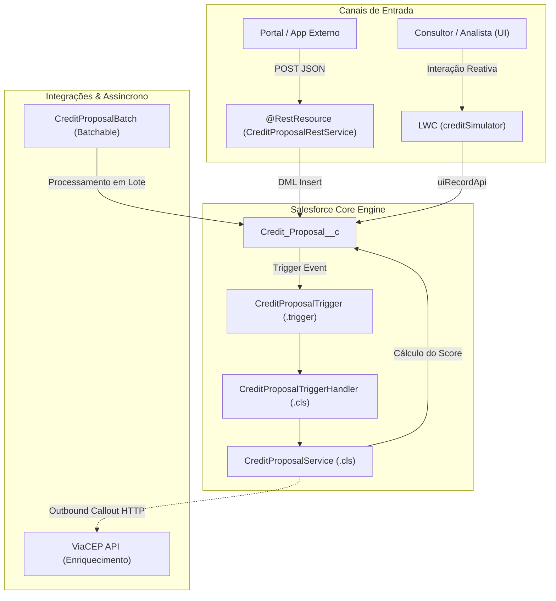

# FinPulse - Sistema Inteligente de Gestão e Análise de Crédito no Salesforce

[](https://developer.salesforce.com/)
[](https://developer.salesforce.com/docs/atlas.en-us.apexcode.meta/apexcode/)
[](https://developer.salesforce.com/docs/component-library/overview/components)
[]()
[]()

> Projeto prático de arquitetura corporativa em Salesforce desenvolvido para atuar como motor de concessão, simulação e esteira de aprovação de crédito para uma fintech financeira.

---

##  Visão Geral do Projeto

O **FinPulse** substitui processos lentos e manuais de concessão de crédito por uma esteira 100% automatizada e auditável dentro do Salesforce:
* **Simulação Interativa (LWC):** Permite simular valores, prazos e garantias com recálculo instantâneo de parcelas e score na tela.
* **Motor de Risco Automatizado (Apex):** Calcula o Score de Risco (0 a 1000) considerando histórico, prazos e índice de cobertura de garantias (Collateral Ratio).
* **Integrações REST Bidirecionais:** Consome APIs externas para enriquecimento de dados cadastrais (Outbound) e expõe endpoints customizados para recebimento de propostas de parceiros externos (Inbound).
* **Processamento Assíncrono de Alto Volume:** Varredura noturna em lote via Batch Apex para expiração e saneamento de propostas inativas.

---

##  Arquitetura da Solução



---

##  Componentes Técnicos do Repositório

### 1. Modelagem de Dados Declarativa (Data Model)
* **`Credit_Proposal__c` (Objeto Pai):** Armazena dados cadastrais, valor solicitado, prazos, score de risco e campos de auditoria.
* **`Proposal_Item__c` (Objeto Filho):** Registra as garantias oferecidas (Imóveis, Veículos, Aplicações) em relacionamento **Master-Detail**.
* **`Total_Collateral_Value__c` (Roll-Up Summary):** Agregação e cálculo automático em tempo real da soma das garantias.
* **Validation Rules:** Bloqueio de regras de negócio (propostas com valor mínimo de R$ 1.000,00 e prazos válidos).

### 2. Backend em Apex & Padrões de Projeto
* **Trigger Handler Pattern:** Separação estrita de responsabilidades entre Trigger, Handler e Service.
* **Bulkificação & Governor Limits:** Código protegido contra limites de SOQL e DML, operando em listas no contexto `before insert` e `before update` sem consumo desnecessário de DML.
* **Segurança e Compartilhamento:** Uso consistente de `with sharing` para respeito integral às Sharing Rules da organização.

### 3. Front-End Moderno com Lightning Web Components (LWC)
* **`creditSimulator`:**
  * Construído com o design system oficial da Salesforce (**SLDS**).
  * Getters reativos para cálculo dinâmico da parcela mensal estimada e badges coloridos de risco (verde, amarelo e vermelho).
  * Criação nativa de registros via `createRecord` (`lightning/uiRecordApi`) e alertas visuais via `ShowToastEvent`.

### 4. Integrações REST
* **Outbound Callout (`ViaCepService`):** Consumo de webservices externos com sanitização de parâmetros, controle de `Remote Site Settings` e tratamento de status codes HTTP.
* **Inbound REST API (`CreditProposalRestService`):** Endpoint customizado `@RestResource(urlMapping='/api/proposals/*')` com anotação `@HttpPost` para recepção de propostas externas via webhook/JSON.

### 5. Apex Assíncrono
* **`CreditProposalBatch`:** Implementação da interface `Database.Batchable<sObject>` com os métodos `start()`, `execute()` e `finish()` para processamento seguro de até 50 milhões de registros em chunks de 200 propostas.

### 6. Testes Automatizados (Apex Unit Tests)
* Cobertura de código com métodos estruturados no padrão **AAA (Arrange, Act, Assert)**.
* Uso de asserções modernas (`Assert.areEqual`).
* Isolamento de transação com `Test.startTest()` e `Test.stopTest()`.
* Técnicas avançadas de teste com desserialização JSON para mock de campos calculados (Roll-Up Summary).

---

## 🚀 Como Executar este Projeto

### Pré-requisitos
* [Salesforce CLI (`sf`)](https://developer.salesforce.com/tools/salesforcecli) instalado.
* Uma Salesforce Developer Edition Org ou Scratch Org ativa.

### 1. Clonar o repositório
```bash
git clone https://github.com/SEU-USUARIO/finpulse-salesforce.git
cd finpulse-salesforce
```

### 2. Autenticar com a sua Org
```bash
sf org login web --alias finpulse-org --set-default
```

### 3. Fazer o deploy completo de todos os metadados
```bash
sf project deploy start --source-dir force-app
```

### 4. Executar os testes automatizados
```bash
sf apex run test --class-names CreditProposalServiceTest --result-format human --code-coverage
```

---

## 👩‍💻 Autora
Desenvolvido por **Tássia Barbosa** como projeto prático de portfólio para desenvolvimento corporativo na plataforma Salesforce.
